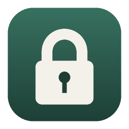

<h1 align="center">NumberLock</h1>

Turn any file, folder or app into a password-locked <code>.txt</code> made of nothing but numbers — and back.

---

Lock something and you get a `.txt` full of digits. Send it however you like. Anyone with NumberLock and the password can turn it back into the original file, folder or app. Everything happens offline, on your own computer.

## Download

Grab the latest version from **[Releases](../../releases/latest)**:

| System | File |
|---|---|
| macOS (Apple Silicon + Intel) | `NumberLock-Mac.zip` |
| Windows 10/11 (64-bit) | `NumberLock-Windows.exe` |
| Linux (64-bit) | `NumberLock-Linux.AppImage` |

Each is a single, portable app of about 5 MB — nothing to install.

### First launch

The apps aren't signed with a paid developer certificate, so your system will warn you the first time:

- **macOS:** unzip, then right-click `NumberLock.app` → **Open** → **Open**. On newer macOS versions use System Settings → Privacy & Security → **Open Anyway**.
- **Windows:** on the blue SmartScreen box click **More info** → **Run anyway**.
- **Linux:** make it runnable (`chmod +x NumberLock-Linux.AppImage`) and double-click it. Some systems need `libfuse2` installed first.

## How to use it

**Lock:** drop a file, folder or app onto the window (or use *Choose files…* / *Choose folder…*), type a password twice, and press **Lock it**. Save the `.txt`.

**Unlock:** switch to *Unlock back to files*, drop the `.txt` in (or paste the numbers), type the password, and press **Unlock**. Files, folders, permissions and links come back exactly as they were, so locked apps still run.

A wrong password, or a single changed digit, is detected and refused.

> **Keep your password safe.** There is no recovery. Without the password, the data can't be unlocked by anyone.

### Good to know

- The numbers are compressed first, but writing data as digits makes it bigger than the compressed data — expect a `.txt` roughly 2× the size of a zipped copy. For example, at the other corrupted looking repo, we have files made with this program, with weird filenames, contents, and the whole repo is build around just those files. I dare you to try and get the encrypted and decrypted files from there! Small things fit in a text message; large apps are better sent as an attachment.
- Locked `.txt` files work on every platform: lock on a Mac, unlock on Windows or Linux.

## Source code

The app is written in Rust with [egui](https://github.com/emilk/egui) for the interface, another repository for console files using this program, and [rfd](https://github.com/PolyMeilex/rfd) for native file dialogs.

| Path | What it is |
|---|---|
| `src/main.rs` | The window, buttons and app flow |
| `src/fsio.rs` | Reading files/folders and rebuilding them (permissions, links, empty folders) |
| `src/core.rs` | **Not published.** The encryption, password hashing and number-conversion system |
| `assets/` | App icon and the script that draws it |
| `package.sh` | Builds and packages all three apps from a Mac |

Because `src/core.rs` is private, this repository does not build on its own. The ready-made apps are on the [Releases](../../releases/latest) page.
